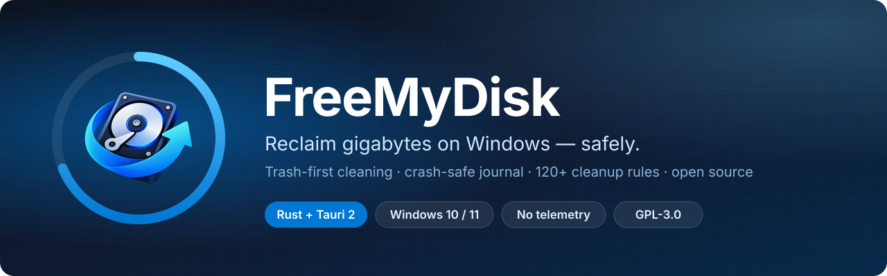
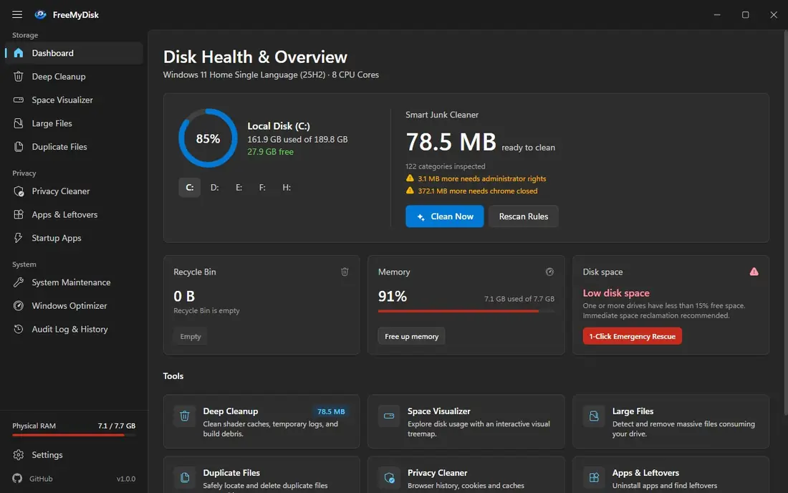
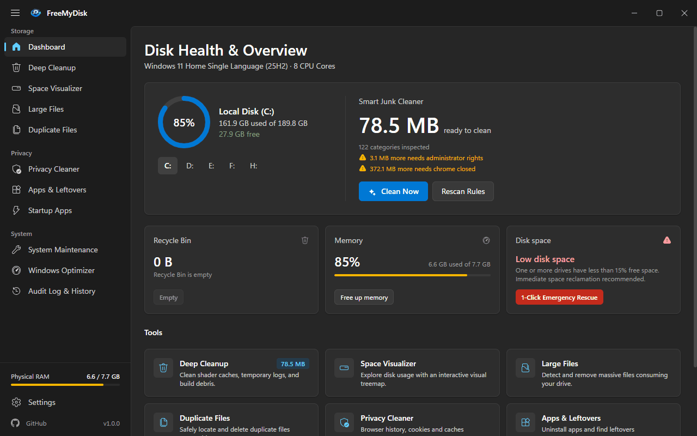
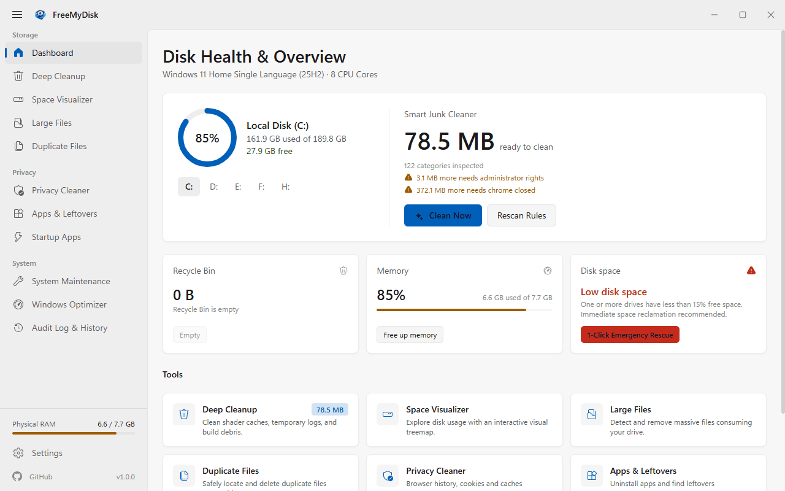
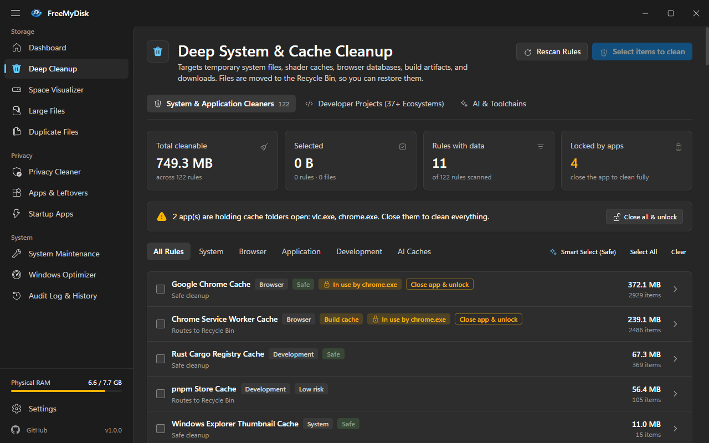
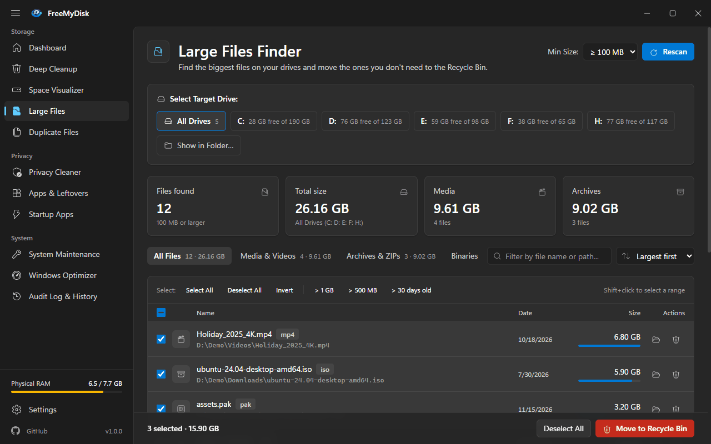
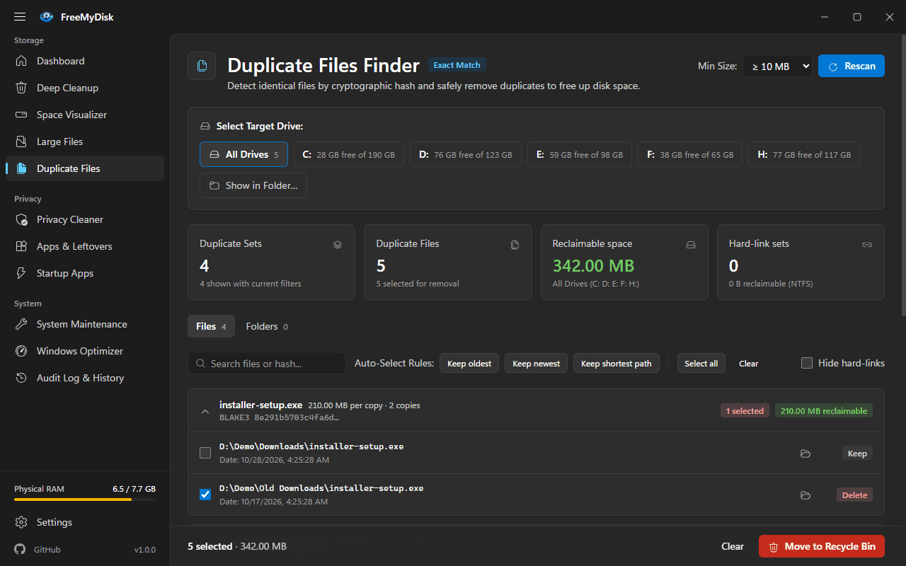
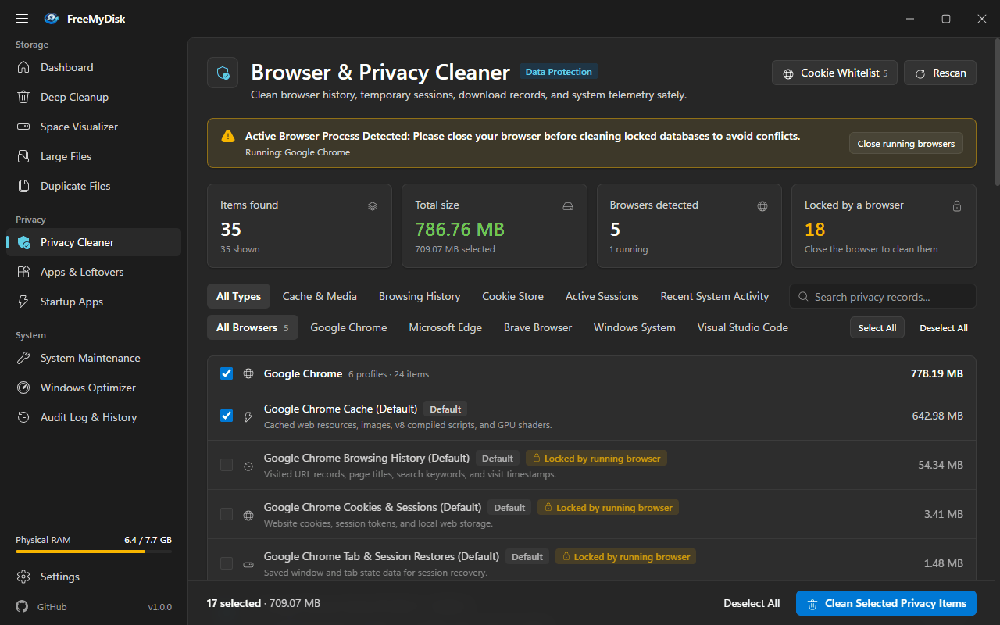
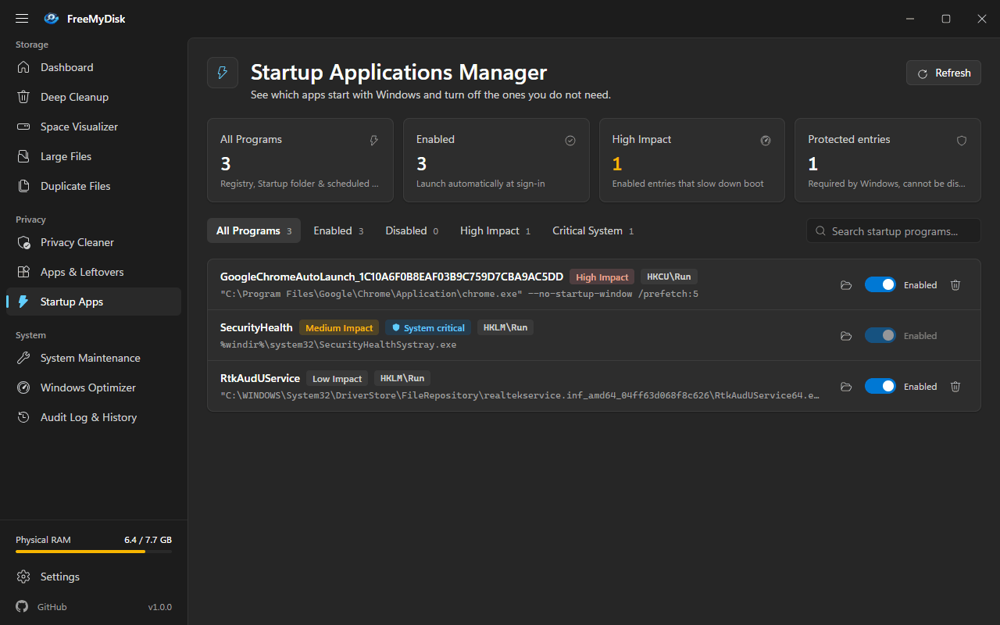
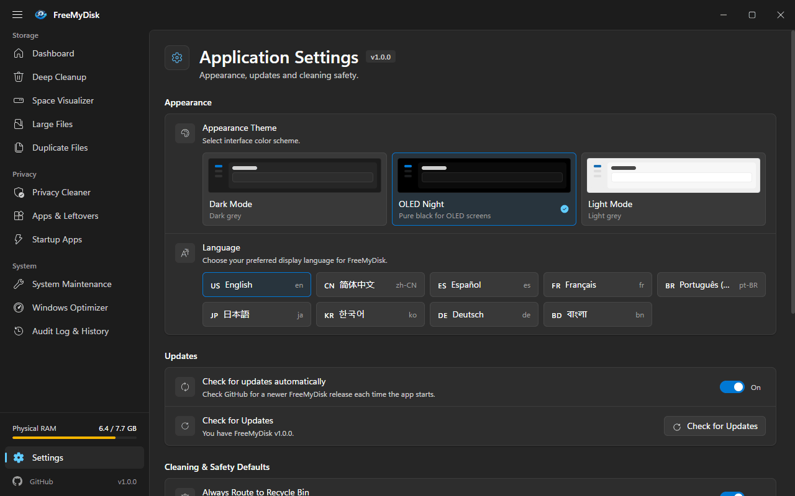

<div align="center">



<br />

### Your drive is full of things you don't need.<br />FreeMyDisk finds them, explains them, and frees the space — without ever risking the things you do need.

<br />

<a href="https://github.com/fzihak/FreeMyDisk/releases/latest"></a>

<a href="#-see-it-in-action"></a>
<a href="#-safe-by-design-not-by-promise"></a>
<a href="#-power-users-the-cli"></a>
<a href="#-add-a-cleanup-rule-in-20-lines"></a>

<br />


</div>

---

## 🎬 See it in action

<div align="center">



<sub>Scan 122 cleanup rules → review what was found → find large files and duplicates → switch themes. Large Files and Duplicates show sample data in this clip.</sub>

</div>

---

## ✨ Why FreeMyDisk?

<table>
<tr>
<td width="50%" valign="top">

### 🛡️ Safe by default
Everything goes to the **Recycle Bin** first. Every deletion is written to a **crash-safe journal** *before* it happens. System folders, files in use, and anything changed in the last 24 hours are left alone.

</td>
<td width="50%" valign="top">

### ⚡ Fast, because it's Rust
A full scan of **122 cleanup rules takes ~9 s**. Large files across 5 drives in **under a minute**. Duplicates are confirmed with **BLAKE3** after cheap size and sample checks, so it only reads what it has to.

</td>
</tr>
<tr>
<td width="50%" valign="top">

### 🔍 It tells you what — and why
No mystery "registry issues found!". Every item shows what it is, which app owns it, whether it's safe to remove, and why something couldn't be cleaned (in use, needs administrator, protected).

</td>
<td width="50%" valign="top">

### 🔒 Private and open
**No accounts, no ads, no telemetry.** The only network request is the optional update check against this repository. Every release is built in public CI and **signed**; every installer carries a **build-provenance attestation**.

</td>
</tr>
</table>

---

## 🧰 Everything in one place

| | Tool | What it does |
| :---: | :--- | :--- |
| 🏠 | **Dashboard** | Drive health at a glance, one-click **Clean Now** that only takes what can succeed right now, Recycle Bin, memory, and low-space rescue. |
| 🧹 | **Deep Cleanup** | **122 rules** for Windows, browsers, apps, developer tools and AI caches — each with risk level, owner app and size. Developer project artifacts (`node_modules`, `target`, build caches) and AI model caches have their own views. |
| 🗺️ | **Space Visualizer** | Interactive treemap of any drive or folder, plus a list of the heaviest folders. |
| 📦 | **Large Files** | Finds the biggest files on every drive, sorted and filterable. System files (`pagefile.sys`, `hiberfil.sys`) and app data are never offered. |
| 👯 | **Duplicates** | Byte-identical duplicates with a keep/delete choice per copy. Hard links count as 0 bytes saved, and it never removes every copy. |
| 🕶️ | **Privacy Cleaner** | Browser history, cookies, caches and sessions, grouped per browser, with a cookie whitelist for the sites you want to stay signed in to. |
| 🧩 | **Apps & Leftovers** | Uninstall apps (desktop and Store) and hunt the files and registry keys they leave behind. |
| 🚀 | **Startup Apps** | See every startup entry with its boot impact; turn things off safely. |
| 🔧 | **Maintenance & Optimizer** | Repair caches, DNS, search index and Windows Update; manage hibernation, Storage Sense, WSL and Docker disks. |
| 🆘 | **Emergency Rescue** | When a drive is nearly full: one guided run that frees space fast — with every step shown before it starts. |
| 🧾 | **Audit Log** | Every operation and its result, plus files queued for deletion on the next restart. |

<details>
<summary><b>📸 Screenshots</b></summary>
<br />

| Dashboard (dark) | Dashboard (light) |
| :---: | :---: |
|  |  |
| **Deep Cleanup** | **Large Files** |
|  |  |
| **Duplicates** | **Privacy Cleaner** |
|  |  |
| **Startup Apps** | **Settings** |
|  |  |

</details>

---

## 🛡️ Safe by design, not by promise

Most cleaners ask you to trust them. FreeMyDisk is built so that a bug, a crash or a misclick can't cost you your files:

| Guarantee | How |
| :--- | :--- |
| **Recycle Bin first** | User-facing deletions go to the Recycle Bin. If that fails, the file is **kept and flagged** — never silently deleted permanently. |
| **Crash-safe journal** | Each deletion is recorded in an SQLite WAL journal *before* it touches the disk. An interrupted cleanup is detected and recovered on the next start. |
| **Protected paths** | Windows, Program Files, user hives and FreeMyDisk itself are behind a non-bypassable protected-path registry. |
| **Nothing in use** | Files held open by a running app are skipped; caches of running browsers are flagged with *"close Chrome to clean"*. |
| **Recent files are kept** | Temp and dump cleaning skips anything modified in the last 24 hours. |
| **Real sizes** | Duplicates and plans deduplicate by physical file identity — hard links never inflate "space saved". |
| **Least privilege** | Runs as a normal user. Admin-only tasks go through a small allow-listed helper behind the Windows UAC prompt. |
| **Signed updates** | Updates are offered, never forced. Downloads are verified against the app's built-in public key before they install. |

---

## ⬇️ Install

1. Download **`FreeMyDisk_<version>_x64-setup.exe`** from the [latest release](https://github.com/fzihak/FreeMyDisk/releases/latest).
2. Run it. Install for just you, or for all users.
3. That's it — FreeMyDisk tells you when a new version is out and updates itself after you say yes.

**Requirements:** Windows 10 or 11 (64-bit) with WebView2 (already part of current Windows).

<details>
<summary><b>Verify your download</b></summary>
<br />

Every installer is built by GitHub Actions from this repository and carries a signed build-provenance attestation:

```powershell
gh attestation verify .\FreeMyDisk_1.1.0_x64-setup.exe --repo fzihak/FreeMyDisk
```

</details>

---

## 💻 Power users: the CLI

The installer ships `freemydisk-cli.exe` — the same engine, scriptable, with `text`, `json` and `csv` output.

```powershell
freemydisk-cli scan --category browser            # what can be cleaned, per rule
freemydisk-cli clean --dry-run                    # show exactly what would happen
freemydisk-cli clean --category development --yes # clean dev caches, no prompt
freemydisk-cli large-files --min-size 500 --limit 20
freemydisk-cli duplicates --roots "D:\Photos" --min-size 5
freemydisk-cli analyze --path "D:\Projects" --depth 3
freemydisk-cli maintenance --list
freemydisk-cli vitals --format json
```

Also available: `artifacts`, `heavy-folders`, `apps`, `privacy`, `startup`, `rescue` and `virtualization`. Run `freemydisk-cli <command> --help` for details.

---

## 🧩 Add a cleanup rule in 20 lines

Rules are plain TOML — no code, no rebuild of the engine logic. This is the real rule for Spotify:

```toml
[rule]
id = "windows_application_spotify_cache"
name = "Spotify Media & Storage Cache"
category = "application"
risk = "safe"
verified_rebuildable = true
description = "Cached streamed audio chunks and offline artwork stored by Spotify"
platform = "windows"
locking_processes = ["spotify.exe"]       # skipped while Spotify is running

[applicability]
conditions = [{ type = "path_exists", path = "${local_app_data}/Spotify/Data" }]

[targets]
paths = [{ path = "${local_app_data}/Spotify/Data/*", matcher = "glob" }]

[disposal]
default_action = "permanent"
protect_subpaths = ["*/Users/*"]
```

Drop a file into [`src-tauri/crates/freemydisk-core/rules/`](src-tauri/crates/freemydisk-core/rules) and open a pull request. Your favourite app's cache could be rule #123.

---

## 🏗️ How it's built

<p align="center"></p>

| Layer | Tech |
| :--- | :--- |
| Engine | Rust 2021 · rayon · BLAKE3 · rusqlite (WAL) · Win32 APIs |
| App | Tauri 2 · React 19 · TypeScript · Tailwind CSS 4 · Zustand |
| Quality | `cargo clippy -D warnings` · Rust integration tests · Vitest · CI on every PR |
| Supply chain | Actions pinned to commit SHAs · protected release environment · signed updates · build attestations |

<details>
<summary><b>Build from source</b></summary>
<br />

```powershell
git clone https://github.com/fzihak/FreeMyDisk.git
cd FreeMyDisk
pnpm install
pnpm tauri dev          # run the app
cargo test --workspace  # Rust tests
pnpm test               # UI tests
pnpm build:bundle       # Windows installer (NSIS)
```

Needs Rust (stable), Node.js 20+, pnpm 9+ and the Visual Studio C++ build tools.

</details>

---

## 🗺️ Roadmap

- [x] Windows 10 / 11 release with signed in-app updates
- [x] 122 cleanup rules incl. developer and AI caches
- [ ] `winget install FreeMyDisk`
- [ ] Scheduled background cleaning
- [ ] macOS and Linux
- [ ] More languages for the UI (9 already included — help translating!)

---

## 🤝 Contributing

Bug reports, rules and translations are all very welcome. Start with [CONTRIBUTING.md](CONTRIBUTING.md), or [open an issue](https://github.com/fzihak/FreeMyDisk/issues/new).

If FreeMyDisk freed some space for you, a star helps other people find it:

<a href="https://github.com/fzihak/FreeMyDisk/stargazers"></a>

<a href="https://star-history.com/#fzihak/FreeMyDisk&Date">
  
</a>

---

<div align="center">

**[GPL-3.0](LICENSE)** · Name and logo: [TRADEMARK.md](TRADEMARK.md) · Made by [@fzihak](https://github.com/fzihak)

</div>
